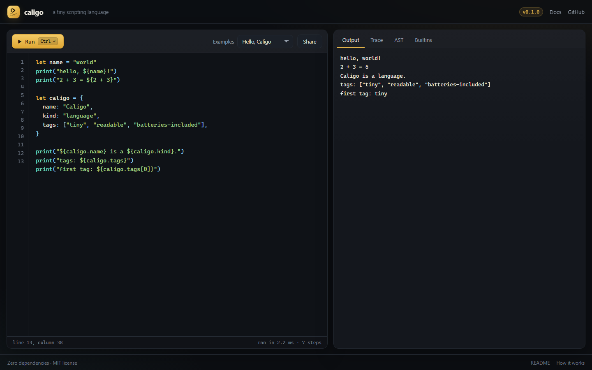

<div align="center">


# Caligo

**A tiny scripting language with pipes, pattern matching, and a playground that shows its work.**

[](https://github.com/jhhjdjj/caligo/actions/workflows/ci.yml)
[](https://github.com/jhhjdjj/caligo/actions/workflows/pages.yml)


[Playground](https://jhhjdjj.github.io/caligo/) ·
[Language guide](docs/language.md) ·
[Builtins](docs/builtins.md) ·
[How it works](docs/design.md) ·
[中文](README.zh-CN.md)

</div>

---

Caligo is a small, dynamically typed language you can learn in an afternoon and
read in one sitting. It has pipes, pattern matching, closures and immutable
data, it runs in Node or in a browser, and it ships with a playground that can
single-step through a program and show you every variable on the way.

- **Zero dependencies.** No parser generator, no runtime library, no build step.
- **Errors that point.** Every error carries a source line, a caret, a hint and
  a call stack.
- **One implementation.** The CLI and the browser playground import the same
  `src/` modules, so they cannot drift apart.
- **Small enough to learn from.** Six source files, each documented, with 121
  tests covering the language, the standard library and the CLI.

## A taste

```caligo
fn fib(n) {
  if n < 2 { n } else { fib(n - 1) + fib(n - 2) }
}

let evenSquares = range(7)
  |> map(fn(n) { n * n })
  |> filter(fn(n) { n % 2 == 0 })

print("fib(10) = ${fib(10)}")
print("even squares: ${evenSquares}")

match evenSquares {
  [] => print("nothing"),
  [first, ...rest] => print("first ${first}, then ${len(rest)} more")
}
```

```
fib(10) = 55
even squares: [0, 4, 16, 36]
first 0, then 3 more
```

## Quick start

Caligo needs Node.js 20 or newer and has no dependencies to install.

```bash
git clone https://github.com/jhhjdjj/caligo.git
cd caligo

node bin/caligo.js                        # start the REPL
node bin/caligo.js run examples/pipelines.caligo
node bin/caligo.js eval "sum(range(10))"  # 45
node bin/caligo.js ast examples/hello.caligo # print the syntax tree
```

To run the playground locally:

```bash
npm run dev      # http://127.0.0.1:4173/
npm test         # 121 tests, no install step needed
```

## The CLI

| Command | What it does |
| --- | --- |
| `caligo` | Start the REPL. `:help`, `:clear`, `:quit`. |
| `caligo run <file> [args]` | Run a `.caligo` program; extra arguments land in the `args` global. |
| `caligo eval <code>` | Evaluate a snippet and print its value. |
| `caligo ast <file>` | Print the syntax tree. |
| `caligo version` · `caligo help` | Print the version or the usage text. |

`--no-color` turns off ANSI colours; `NO_COLOR=1` works too. Errors go to stderr
and use exit code 1, usage mistakes use exit code 2.

## The language at a glance

```caligo
// values
let name = "world"
const answer = 42
let things = [1, "two", nil, { nested: true }]
let scores = { alice: 10, bob: 7 }

// string interpolation
print("hello, ${name}! ${answer} squared is ${answer * answer}")

// functions and closures
fn add(a, b) { a + b }
let double = fn(x) { x * 2 }

// control flow is made of expressions
let mood = if answer > 10 { "high" } else { "low" }
for index, thing in things { print(index, thing) }

// pipes put the value first
let total = scores
  |> values()
  |> filter(fn(score) { score > 7 })
  |> sum()

// pattern matching
match things {
  [] => print("empty"),
  [only] => print("just ${only}"),
  [first, ...rest] => print("${first} + ${len(rest)} more"),
  _ => print("something else")
}
```

Things that might surprise you, in a good way:

- **Everything is an expression.** `if`, blocks and function bodies all produce
  values, so `let x = if ok { 1 } else { 2 }` needs no ceremony.
- **Only `nil` and `false` are falsy.** `0` and `""` are truthy.
- **Lists and maps are immutable.** `setAt`, `append`, `put` and `merge` return
  new values; there is no `xs[i] = v`.
- **Pipes pass the value as the first argument:** `x |> f(a)` is `f(x, a)`.
- **`match` is not exhaustive by default**, but a missing arm is a clear runtime
  error and the message suggests adding `_ => ...`.

The complete reference — grammar, operator precedence, patterns, limits — is in
[docs/language.md](docs/language.md). The standard library fits on one generated
page: [docs/builtins.md](docs/builtins.md).

## The playground

<p align="center">
  
</p>

The playground is the same interpreter running in your browser:

- syntax highlighting produced by the real lexer (not a second grammar);
- an output pane that also shows the value of the last expression;
- a **trace** tab that records every executed statement with its variables;
- an **AST** tab that prints the parse tree;
- a **builtins** tab with signatures and documentation;
- share links that gzip the program into the URL fragment — no server involved.

It is plain HTML, CSS and ES modules: open `index.html` through any static file
server (or `npm run dev`) and it works. Push to `main` and the included
[Pages workflow](.github/workflows/pages.yml) publishes it.

## Project layout

```
src/            the language: lexer, parser, interpreter, builtins, errors
bin/caligo.js     the CLI entry point
web/            playground assets (no build step)
index.html      the playground page
examples/       programs used by the docs, the playground and the tests
docs/           language reference, builtins, implementation notes
test/           node:test suites
scripts/        dev server, site build, doc generators, test runner
```

## Design notes

Caligo is a tree-walking interpreter: a hand-written lexer, a recursive-descent
parser with precedence climbing, and an evaluator with lexical environments.
Spans are absolute character offsets from the very beginning, which is what makes
error carets, trace positions and the AST viewer agree with each other.

Three decisions shaped the rest:

1. **Newlines are tokens.** They separate statements, but an expression keeps
   going when the next line starts with a binary operator — so pipes can be
   stacked down the page.
2. **Braces mean maps, keywords introduce blocks.** `{ a: 1 }` is a map;
   `if x { ... }` is a block. No ambiguity, no lookahead tricks.
3. **Blocks are expressions, data is immutable.** Values flow out of `if` and
   function bodies; there is no mutation through references.

[docs/design.md](docs/design.md) walks through the pipeline, the environment
model, the call protocol, the tracer and the playground.

## Roadmap

- [ ] `caligo fmt` — a formatter based on the AST
- [ ] `import` / modules
- [ ] destructuring in `let`
- [ ] richer patterns (guards, alternatives)
- [ ] a small `caligo test` runner for `.caligo` files

Ideas and issues are welcome; see [CONTRIBUTING.md](CONTRIBUTING.md).

## Contributing

No install step, no build step:

```bash
npm test                    # language, builtins and CLI tests
npm run dev                 # playground on http://127.0.0.1:4173/
npm run docs:builtins       # regenerate docs/builtins.md
npm run build:examples      # regenerate web/examples.js from examples/
```

New builtins and syntax features have short checklists in
[CONTRIBUTING.md](CONTRIBUTING.md) and [docs/design.md](docs/design.md).

## Prior art

Caligo is not a fork or a port; the code was written for this project. Its
ingredients come from languages that do each thing better:

- pipes from Elixir and F#;
- pattern matching from ML, Ruby and Rust;
- immutable data from Clojure and Elixir;
- blocks as expressions from Ruby and Rust;
- the classic interpreter shape from *Crafting Interpreters*, whose book is a
  wonderful place to start if you want to build your own.

## License

MIT — see [LICENSE](LICENSE). *Caligo* is Latin for mist.
